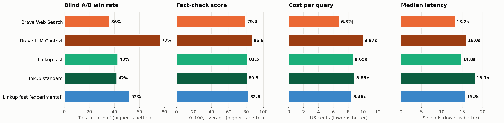
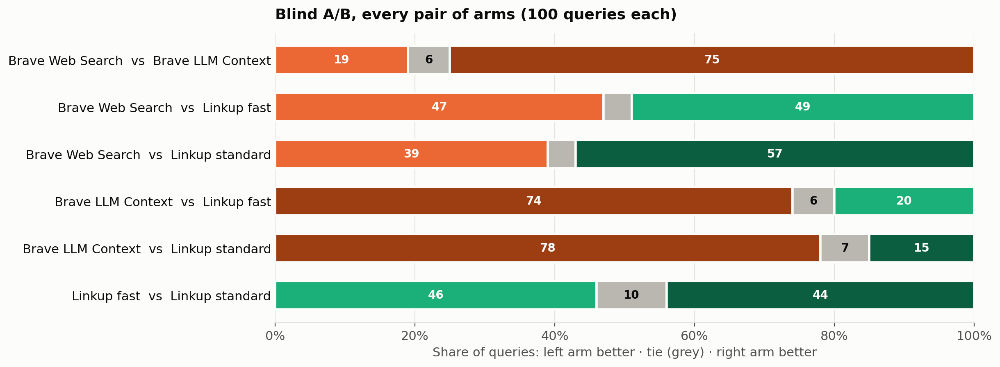
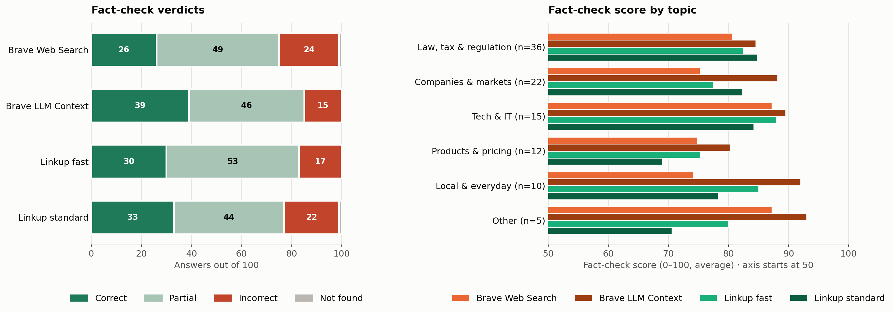
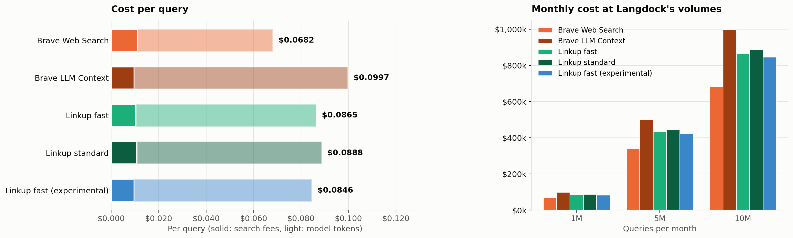
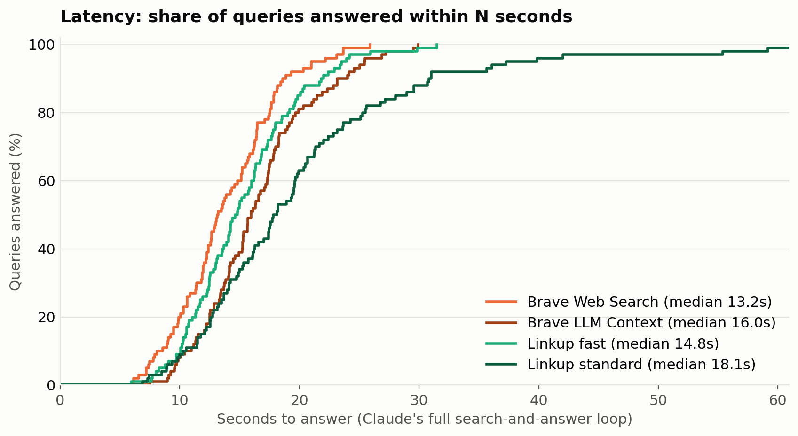

# Linkup vs Brave on Langdock's search queries

Claude Sonnet 5.5 answered 100 of Langdock's search queries five times, each time with a different search tool: Brave's Web Search API, Brave's LLM Context API, Linkup `fast`, Linkup `standard`, and Linkup `fast` on an experimental API key. Same model, same prompt, same 10-search cap. Two separate graders scored the answers: a blind A/B comparison of every pair of arms, and a fact-check in which a judge verifies each answer's claims with its own web search.

- **Blind A/B:** Brave LLM Context has the highest win rate (77%); see every pair below.
- **Fact-check:** Brave LLM Context scores highest (86.8 out of 100, 39 answers fully correct).
- **Cost per query:** lowest with Brave Web Search ($0.0682).
- **Median latency:** lowest with Brave Web Search (13.2s).

| Metric | Brave Web Search | Brave LLM Context | Linkup fast | Linkup standard | Linkup fast (experimental) |
|---|---|---|---|---|---|
| Blind A/B win rate (ties count half) | 36% | 77% | 43% | 42% | 52% |
| Fact-check score (0–100) | 79.4 | 86.8 | 81.5 | 80.9 | 82.8 |
| Fully correct (fact-check) | 26 | 39 | 30 | 33 | 30 |
| Cost per query | $0.0682 | $0.0997 | $0.0865 | $0.0888 | $0.0846 |
| Cost per correct answer | $0.2622 | $0.2557 | $0.2883 | $0.2690 | $0.2821 |
| Median latency | 13.2s | 16.0s | 14.8s | 18.1s | 15.8s |

## Setup

|  | Brave Web Search | Brave LLM Context | Linkup fast | Linkup standard | Linkup fast (experimental) |
|---|---|---|---|---|---|
| Model | `claude-sonnet-5-5` | `claude-sonnet-5-5` | `claude-sonnet-5-5` | `claude-sonnet-5-5` | `claude-sonnet-5-5` |
| Endpoint | `/res/v1/web/search` | `/res/v1/llm/context` | `/v1/search`, `depth=fast` | `/v1/search`, `depth=standard` | `/v1/search`, `depth=fast`, experimental API key |
| Settings | `count=10`, `extra_snippets=true` | `count=10`; default 8,192-token budget and relevance threshold | `searchResults`, `maxResults=10` | `searchResults`, `maxResults=10` | `searchResults`, `maxResults=10` |
| What Claude sees per result | title, URL, date, description, up to 5 extra snippets | title, URL, date, extracted page chunks | title, URL, content | title, URL, content | title, URL, content |
| Search price (per 1,000) | $5.00 (list) | $5.00 (list) | $5.00 (list) | $5.00 (list) | $5.00 (list) |
| Search cap | 10 per query | 10 per query | 10 per query | 10 per query | 10 per query |

Claude decides what to search for and how often. Each tool description asks for the query style its provider is built for: keyword queries for Brave, natural-language retrieval instructions for Linkup. Neither provider gets a location hint: Brave runs without `country` or `search_lang`, and Linkup has no location setting. On Brave's LLM Context endpoint, `maximum_number_of_urls=10` did not limit the response in our runs: it returned 27.9 pages per search on average, and only the token budget changed how much came back. Brave's docs say the snippet limits give way to the token budget, but don't say this for the URL limit.

**Queries:** a random sample (fixed seed) of 100 of the 1,000 synthetic search queries Langdock shared on October 16, 2026 as typical of what its product sends to a search API. Each query is sent to Claude as the user's message, with a system prompt for an enterprise assistant used by companies in Germany and across Europe. 58 are in German, 37 in English and 5 in other languages. `gpt-6-luna` tagged each query with a topic.

**Grading:** the queries have no answer key, so two `gpt-6-luna` graders score the answers. Their results are reported separately.
- **Blind A/B:** for every pair of arms, the judge sees the query and both answers in random order, with no labels and no web access, and picks the one the user would rather get, or a tie. It weighs whether the answer gives what the query is looking for, then correctness as far as it can tell, then honesty about gaps. Citations, length and style don't count.
- **Fact-check:** the judge sees one answer at a time and checks up to 5 of its most important claims with its own web search (OpenAI's, independent of all arms), marking each supported, contradicted or unverifiable. It gives a verdict (correct / partial / incorrect / not found) and a score out of 100: answers the query 30, accuracy 50 (minus 25 for each contradicted central claim and 10 for each other contradicted claim), freshness 10, calibration 10.

## Blind A/B

| Pair | Left better | Tie | Right better | Sign test |
|---|---|---|---|---|
| Brave Web Search vs Brave LLM Context | 19 | 6 | 75 | p < 0.001 |
| Brave Web Search vs Linkup fast | 47 | 4 | 49 | p = 0.92 |
| Brave Web Search vs Linkup standard | 39 | 4 | 57 | p = 0.08 |
| Brave Web Search vs Linkup fast (experimental) | 32 | 2 | 66 | p < 0.001 |
| Brave LLM Context vs Linkup fast | 74 | 6 | 20 | p < 0.001 |
| Brave LLM Context vs Linkup standard | 78 | 7 | 15 | p < 0.001 |
| Brave LLM Context vs Linkup fast (experimental) | 68 | 4 | 28 | p < 0.001 |
| Linkup fast vs Linkup standard | 46 | 10 | 44 | p = 0.92 |
| Linkup fast vs Linkup fast (experimental) | 42 | 9 | 49 | p = 0.53 |
| Linkup standard vs Linkup fast (experimental) | 39 | 5 | 56 | p = 0.10 |

## Fact-check

| Metric | Brave Web Search | Brave LLM Context | Linkup fast | Linkup standard | Linkup fast (experimental) |
|---|---|---|---|---|---|
| Correct | 26 | 39 | 30 | 33 | 30 |
| Partial | 49 | 46 | 53 | 44 | 50 |
| Incorrect | 24 | 15 | 17 | 22 | 20 |
| Not found | 1 | 0 | 0 | 1 | 0 |
| Score (0–100, average) | 79.4 (75.8–82.8) | 86.8 (84.0–89.4) | 81.5 (78.0–84.8) | 80.9 (76.9–84.8) | 82.8 (79.6–85.8) |
|   Answers the query (of 30) | 25.0 | 26.8 | 25.2 | 24.8 | 25.9 |
|   Accuracy (of 50) | 37.9 | 42.4 | 39.3 | 39.5 | 40.1 |
|   Freshness (of 10) | 8.9 | 9.2 | 8.8 | 8.5 | 8.7 |
|   Calibration (of 10) | 7.7 | 8.4 | 8.1 | 8.1 | 8.1 |
| Claims contradicted by the judge's sources | 81 of 460 (17.6%) | 57 of 462 (12.3%) | 79 of 455 (17.4%) | 73 of 458 (15.9%) | 69 of 471 (14.6%) |
| Answers with at least one contradicted claim | 61 | 49 | 57 | 50 | 58 |

Score differences between arms, per query:

| Pair | Score difference (right − left) | 95% CI | Sign test (5+ points) |
|---|---|---|---|
| Brave Web Search vs Brave LLM Context | +7.4 | +3.6 to +11.3 | p = 0.04 |
| Brave Web Search vs Linkup fast | +2.1 | -2.2 to +6.2 | p = 0.82 |
| Brave Web Search vs Linkup standard | +1.5 | -3.1 to +6.2 | p = 0.08 |
| Brave Web Search vs Linkup fast (experimental) | +3.4 | -0.5 to +7.2 | p = 0.22 |
| Brave LLM Context vs Linkup fast | -5.3 | -8.8 to -1.8 | p = 0.006 |
| Brave LLM Context vs Linkup standard | -5.8 | -9.9 to -1.8 | p = 0.11 |
| Brave LLM Context vs Linkup fast (experimental) | -3.9 | -6.8 to -1.0 | p = 0.04 |
| Linkup fast vs Linkup standard | -0.5 | -4.6 to +3.5 | p = 1.00 |
| Linkup fast vs Linkup fast (experimental) | +1.4 | -2.0 to +4.7 | p = 0.71 |
| Linkup standard vs Linkup fast (experimental) | +1.9 | -2.3 to +6.0 | p = 1.00 |

## Cost

| Per query | Brave Web Search | Brave LLM Context | Linkup fast | Linkup standard | Linkup fast (experimental) |
|---|---|---|---|---|---|
| Total cost | $0.0682 | $0.0997 | $0.0865 | $0.0888 | $0.0846 |
| Cost per correct answer | $0.2622 | $0.2557 | $0.2883 | $0.2690 | $0.2821 |
| Search fees | $0.0112 | $0.0098 | $0.0104 | $0.0108 | $0.0097 |
| Model tokens | $0.0570 | $0.0900 | $0.0761 | $0.0780 | $0.0749 |
| Searches | 2.23 | 1.95 | 2.08 | 2.16 | 1.94 |
| Input tokens (incl. cache) | 18,488 | 29,762 | 28,439 | 31,650 | 26,181 |
| Output tokens | 1,784 | 1,988 | 1,877 | 1,864 | 1,857 |

| Queries per month | Brave Web Search | Brave LLM Context | Linkup fast | Linkup standard | Linkup fast (experimental) |
|---|---|---|---|---|---|
| 1,000,000 | $68,183 | $99,740 | $86,480 | $88,757 | $84,629 |
| 5,000,000 | $340,916 | $498,698 | $432,398 | $443,785 | $423,143 |
| 10,000,000 | $681,833 | $997,395 | $864,797 | $887,570 | $846,286 |

Search fees are at list price: $5.00 per 1,000 calls for both Brave (the Search plan covers both endpoints) and Linkup, so cost differences come from how many searches Claude makes and how much text it reads and writes. Prices: Sonnet 5.5 $2.00 / $10.00 per million input / output tokens (cache reads $0.20, cache writes $2.50). Volume discounts on either side are not included.

## Latency

| Metric | Brave Web Search | Brave LLM Context | Linkup fast | Linkup standard | Linkup fast (experimental) |
|---|---|---|---|---|---|
| Median latency | 13.2s | 16.0s | 14.8s | 18.1s | 15.8s |
| p90 latency | 18.9s | 24.0s | 22.0s | 31.0s | 22.7s |

Latency is the whole loop: Claude's turns plus every search call, from the query to the final answer.

## Topics and languages

| Topic | Queries | Brave Web Search: A/B win rate / score | Brave LLM Context: A/B win rate / score | Linkup fast: A/B win rate / score | Linkup standard: A/B win rate / score | Linkup fast (experimental): A/B win rate / score |
|---|---|---|---|---|---|---|
| Law, tax & regulation | 36 | 30% / 81 | 81% / 85 | 39% / 82 | 48% / 85 | 53% / 83 |
| Companies & markets | 22 | 48% / 75 | 73% / 88 | 44% / 78 | 36% / 82 | 49% / 78 |
| Tech & IT | 15 | 33% / 87 | 69% / 90 | 56% / 88 | 36% / 84 | 56% / 89 |
| Products & pricing | 12 | 34% / 75 | 80% / 80 | 29% / 75 | 45% / 69 | 61% / 80 |
| Local & everyday | 10 | 49% / 74 | 72% / 92 | 56% / 85 | 32% / 78 | 40% / 85 |
| Other | 5 | 20% / 87 | 85% / 93 | 38% / 80 | 57% / 71 | 50% / 89 |
| German | 58 | 36% / 78 | 75% / 86 | 41% / 80 | 46% / 79 | 52% / 81 |
| English | 37 | 38% / 81 | 77% / 88 | 48% / 84 | 35% / 83 | 52% / 85 |
| Other languages | 5 | 25% / 83 | 95% / 90 | 32% / 88 | 40% / 82 | 57% / 83 |

## Caveats

- 100 queries: differences of a few queries either way are within noise; the sign tests and confidence intervals above say how likely each gap is by chance.
- The queries are synthetic examples from Langdock, not production traffic.
- Both graders are a single LLM (`gpt-6-luna`). The fact-checker can only mark a claim contradicted when its own search finds a better source, so it under-counts errors on niche topics.
- Each arm was run with one configuration. Brave with `country=DE`, or different result counts and token budgets on either side, may score differently.

## Files

- `data/`: the 100 queries with topic and language, each arm's answers (with the searches Claude ran, tokens, latency and retrieved URLs), and every grade with the judge's reasoning
- `charts/`: the charts above
- `build.py`: rebuilds `charts/` and this README from `data/` (`python3 build.py`)
