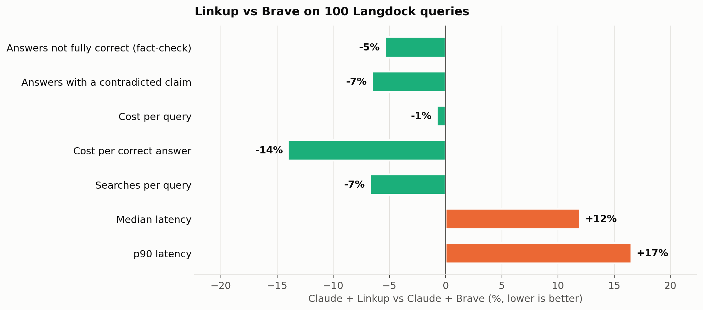

# Linkup vs Brave on Langdock's search queries

Claude Sonnet 5.5 answered 100 of Langdock's search queries twice: once with the Brave Web Search API as its search tool (**Brave**) and once with Linkup (**Linkup**). Same model, same prompt, same 10-search cap. Two separate graders scored the answers: a blind A/B comparison, and a fact-check in which a judge verifies each answer's claims with its own web search.

- **Blind A/B:** Linkup's answer was better on 49 queries and Brave's on 47, with 4 ties (sign test p = 0.92).
- **Fact-check:** 30 of Linkup's answers were fully correct vs 26 of Brave's; average score 81.5 vs 79.4 out of 100.
- **Cost per query:** Linkup $0.0676, Brave $0.0682 (1% lower); per correct answer Linkup $0.2255, Brave $0.2622 (14% lower).
- **Median latency:** Linkup 14.8s, Brave 13.2s (12% higher).

## Setup

| | Brave | Linkup |
|---|---|---|
| Model | `claude-sonnet-5-5` | `claude-sonnet-5-5` |
| Search | Brave Web Search API `/res/v1/web/search`: 10 results, `extra_snippets=true` (title, URL, date, description and up to 5 extra excerpts per result) | Linkup `/v1/search`: `fast` depth, `searchResults`, 10 results |
| Search cap | 10 per query | 10 per query |
| Search price | $5.00 per 1,000 requests (list) | $4.00 per 1,000 calls (offered to Langdock; list $5.00) |

Claude decides what to search for and how often. Each tool description asks for the query style its provider is built for: keyword queries for Brave, natural-language retrieval instructions for Linkup. Brave runs with its default settings (no `country` or `search_lang`), and Linkup has no location setting, so neither arm gets a location hint.

**Queries:** a random sample (fixed seed) of 100 of the 1,000 synthetic search queries Langdock shared on October 16, 2026 as typical of what its product sends to a search API. Each query is sent to Claude as the user's message, with a system prompt for an enterprise assistant used by companies in Germany and across Europe. 58 are in German, 37 in English and 5 in other languages. `gpt-6-luna` tagged each query with a topic.

**Grading:** the queries have no answer key, so two `gpt-6-luna` graders score the answers. Their results are reported separately.
- **Blind A/B:** the judge sees the query and both answers in random order, with no labels and no web access, and picks the one the user would rather get, or a tie. It weighs whether the answer gives what the query is looking for, then correctness as far as it can tell, then honesty about gaps. Citations, length and style don't count.
- **Fact-check:** the judge sees one answer at a time and checks up to 5 of its most important claims with its own web search (OpenAI's, independent of both arms), marking each supported, contradicted or unverifiable. It gives a verdict (correct / partial / incorrect / not found) and a score out of 100: answers the query 30, accuracy 50 (minus 25 for each contradicted central claim and 10 for each other contradicted claim), freshness 10, calibration 10.

## Blind A/B

| Queries | n | Linkup better | Tie | Brave better |
|---|---|---|---|---|
| All | 100 | **49** | 4 | **47** |
| German | 58 | 29 | 1 | 28 |
| English | 37 | 17 | 3 | 17 |
| Other languages | 5 | 3 | 0 | 2 |
| Law, tax & regulation | 36 | 18 | 0 | 18 |
| Companies & markets | 22 | 11 | 2 | 9 |
| Tech & IT | 15 | 8 | 1 | 6 |
| Products & pricing | 12 | 5 | 0 | 7 |
| Local & everyday | 10 | 4 | 1 | 5 |
| Other | 5 | 3 | 0 | 2 |

## Fact-check

| Metric | Brave | Linkup | Linkup vs Brave |
|---|---|---|---|
| Correct (fact-check verdict) | 26 | 30 | +4 |
| Partial | 49 | 53 | +4 |
| Incorrect | 24 | 17 | -7 |
| Not found | 1 | 0 | -1 |
| Score (0–100, average) | 79.4 | 81.5 | +2.1 (95% CI -2.2 to +6.2) |
|   Answers the query (of 30) | 25.0 | 25.2 | +0.2 |
|   Accuracy (of 50) | 37.9 | 39.3 | +1.4 |
|   Freshness (of 10) | 8.9 | 8.8 | -0.1 |
|   Calibration (of 10) | 7.7 | 8.1 | +0.4 |
| Claims checked | 460 | 455 |  |
| Claims contradicted by the judge's sources | 81 (17.6%) | 79 (17.4%) |  |
| Answers with at least one contradicted claim | 61 | 57 | -4 |
| Queries only this arm got fully correct | 16 | 20 | sign test p = 0.62 |
| Queries where this arm scored 5+ points higher | 39 | 42 | sign test p = 0.82 |

## Cost

| Per query | Brave | Linkup | Linkup vs Brave |
|---|---|---|---|
| Total cost | $0.0682 | $0.0676 | 1% lower |
| Cost per correct answer | $0.2622 | $0.2255 | 14% lower |
| Search fees | $0.0112 | $0.0083 | 25% lower |
| Model tokens | $0.0570 | $0.0593 | 4% higher |
| Searches | 2.23 | 2.08 | 7% lower |
| Input tokens (incl. cache) | 18,488 | 20,227 | 9% higher |
| Output tokens | 1,784 | 1,877 | 5% higher |

| Queries per month | Brave | Linkup | Difference |
|---|---|---|---|
| 1,000,000 | $68,183 | $67,640 | Linkup $543 cheaper |
| 5,000,000 | $340,916 | $338,199 | Linkup $2,717 cheaper |
| 10,000,000 | $681,833 | $676,399 | Linkup $5,434 cheaper |

Linkup cost reflects the snippet compressor (30% fewer retrieved tokens), releasing the week of October 19, 2026.

Search fees are Brave at its $5.00 list price and Linkup at the $4.00 per 1,000 calls offered to Langdock (20% off list); the rest of the cost gap comes from how much text Claude reads and writes. Prices: Sonnet 5.5 $2.00 / $10.00 per million input / output tokens (cache reads $0.20, cache writes $2.50); Brave Search plan $5.00 per 1,000 requests (extra snippets included); Linkup `fast` $4.00 per 1,000 calls. Any volume discount Brave offers Langdock is not included.

## Latency

| Metric | Brave | Linkup | Linkup vs Brave |
|---|---|---|---|
| Median latency | 13.2s | 14.8s | 12% higher |
| p90 latency | 18.9s | 22.0s | 17% higher |

Latency is the whole loop: Claude's turns plus every search call, from the query to the final answer.

## Topics and languages

| Topic | Queries | A/B: Linkup / tie / Brave | Brave fact-check score | Linkup fact-check score |
|---|---|---|---|---|
| Law, tax & regulation | 36 | 18 / 0 / 18 | 80.6 | 82.4 |
| Companies & markets | 22 | 11 / 2 / 9 | 75.3 | 77.5 |
| Tech & IT | 15 | 8 / 1 / 6 | 87.2 | 87.9 |
| Products & pricing | 12 | 5 / 0 / 7 | 74.8 | 75.3 |
| Local & everyday | 10 | 4 / 1 / 5 | 74.1 | 85.0 |
| Other | 5 | 3 / 0 / 2 | 87.2 | 80.0 |
| German | 58 | 29 / 1 / 28 | 77.8 | 79.5 |
| English | 37 | 17 / 3 / 17 | 81.4 | 83.6 |
| Other languages | 5 | 3 / 0 / 2 | 83.2 | 88.0 |

## Caveats

- 100 queries: differences of a few queries either way are within noise; the sign tests above say how likely each split is by chance.
- The queries are synthetic examples from Langdock, not production traffic.
- Both graders are a single LLM (`gpt-6-luna`). The fact-checker can only mark a claim contradicted when its own search finds a better source, so it under-counts errors on niche topics.
- Brave and Linkup were each run with one configuration. Brave with a `country=DE` setting, or Linkup at `standard` depth, may score differently.

## Files

- `data/`: the 100 queries with topic and language, both arms' answers (with the searches Claude ran, tokens, latency and retrieved URLs), and every grade with the judge's reasoning
- `charts/`: the charts above
- `build.py`: rebuilds `charts/` and this README from `data/` (`python3 build.py`)
